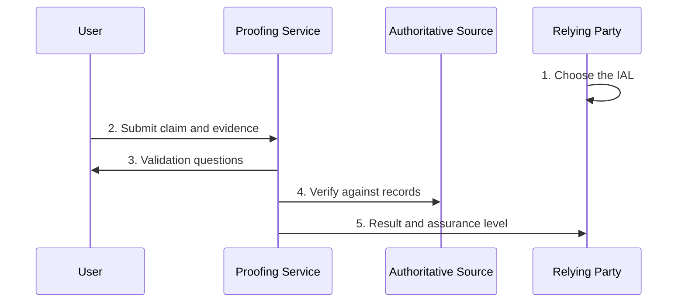
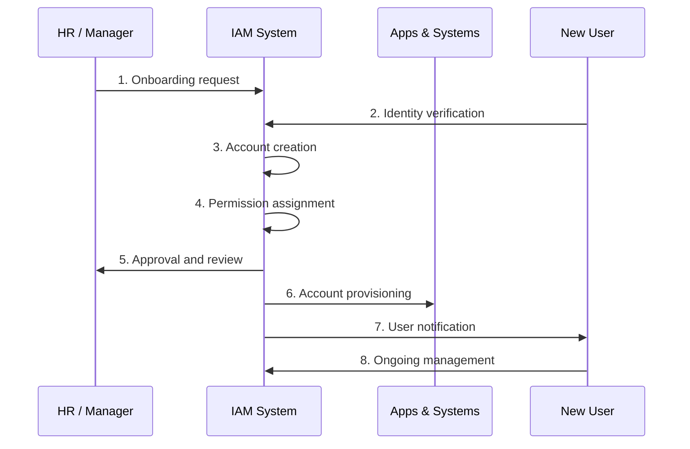
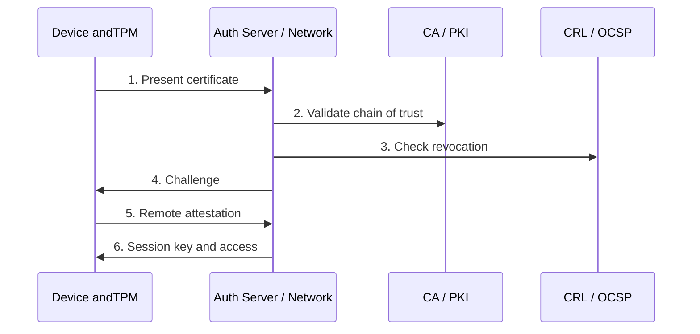
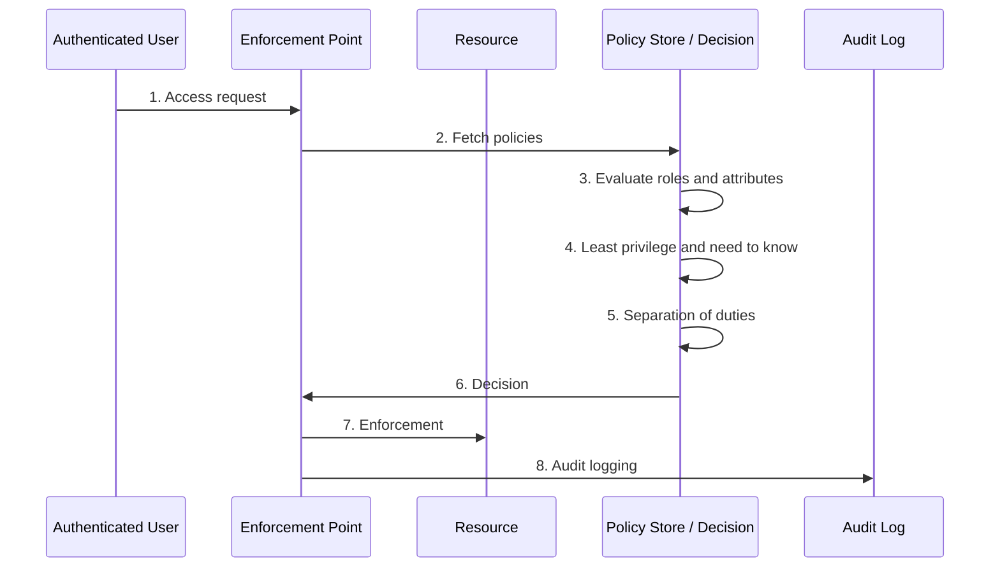
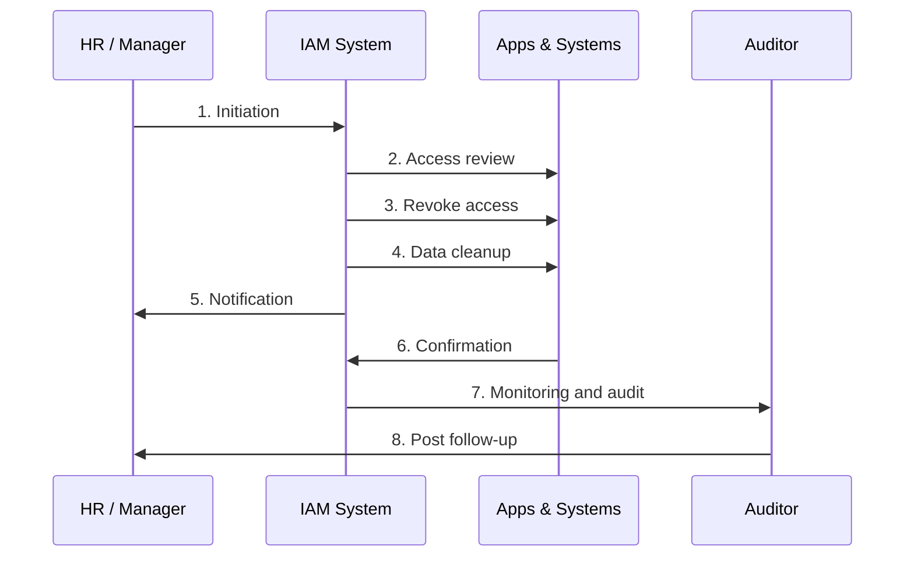

# Identity & Access Lifecycle: Study Guide

Covers Identity Proofing, Provisioning, Device Authentication, Authorization and Deprovisioning. For the animated version open `iam-lifecycle-simulator.html`; the sequence diagrams below render in any Mermaid-enabled Markdown viewer.

## 🪪 Identity Proofing

Confirming that a claimed identity is real and belongs to the person claiming it, usually at enrollment. Assurance level depends on risk: IAL1 = self-asserted or minimal evidence; IAL2 = verified via an online identity service; IAL3 = in-person, biometric and documentary proof.

### Flow

### Working principle (step by step)

1. **Choose the IAL** (Relying Party → Relying Party): The organization assesses the risk of the access being granted and picks IAL1, IAL2 or IAL3.
2. **Submit claim and evidence** (User → Proofing Service): The user supplies name, documents or biometrics. Higher IAL means stronger evidence.
3. **Validation questions** (Proofing Service → User): The user answers pre-established questions plus data such as an account number or billing postal code.
4. **Verify against records** (Proofing Service → Authoritative Source): The service checks that documents and answers match a real person in an authoritative source (civil registry, bank, issuer).
5. **Result and assurance level** (Proofing Service → Relying Party): The service confirms the identity is valid and reports the IAL achieved, so the relying party can enroll the user.

### Key concepts

- **IAL1**: Low confidence. Self-asserted or minimal evidence.
- **IAL2**: Online identity authentication service (e.g. verified through established online accounts).
- **IAL3**: Highest. In-person check, biometrics and documents.

### Pros

- Stops impersonation at the very start
- Establishes trust for all later authentication
- Scales to remote onboarding (eKYC)
- Assurance level matches risk

### Cons

- Higher IAL costs time and money
- Biometrics and documents raise privacy concerns
- Forged documents and deepfakes remain a threat
- Can exclude people without standard ID

### Applications

- **Commercial**: Bank eKYC and account opening, fintech wallets, SIM registration
- **Government**: National ID biometric checks (e.g. NADRA in Pakistan), NIST SP 800-63A, Login.gov
- **Defense**: In-person credential issuance for military smart cards (DEERS/CAC)
- **Healthcare**: Patient and prescriber identity before e-prescribing

---

## ➕ Provisioning

Creating, managing and maintaining accounts and access rights. It applies to humans and, increasingly, to non-human identities such as robots, IoT devices and endpoints.

### Flow

### Working principle (step by step)

1. **Onboarding request** (HR / Manager → IAM System): Hire, manager or admin submits name, title, department and needed access.
2. **Identity verification** (New User → IAM System): Official documents are inspected before any account exists.
3. **Account creation** (IAM System → IAM System): Unique username, password (or user sets one), groups/roles in AD or LDAP. A smart card, hardware or soft token may be issued.
4. **Permission assignment** (IAM System → IAM System): Rights to systems, databases and files are set from role, department or special need.
5. **Approval and review** (IAM System → HR / Manager): The manager or authorized admin confirms access matches business need and policy.
6. **Account provisioning** (IAM System → Apps & Systems): Account and rights are pushed to target systems, automatically or manually.
7. **User notification** (IAM System → New User): The user receives credentials, permissions and security guidance.
8. **Ongoing management** (New User → IAM System): Role changes, transfers and promotions keep updating access through the life cycle.

### Key concepts

- **Manual**: Admins handle each request; batch updates may take days in large enterprises.
- **Self-service**: Users reset passwords, update contact data, or click Request access for more privileges.
- **Just in Time (JIT)**: Account is created on first access, only when needed (e.g. joining a blog or wiki), reducing dormant accounts.
- **Automated**: Identity tools create and maintain accounts with fewer errors and less effort.

### Pros

- Fast, consistent onboarding
- Role-based rights enforce policy
- Automation cuts errors and cost
- Audit trail for compliance

### Cons

- Role mis-mapping gives over-privilege
- Manual and batch methods are slow
- Integration with many systems is complex
- Orphaned or dormant accounts if not maintained

### Applications

- **Commercial**: Okta, Microsoft Entra ID, SailPoint; SCIM sync to SaaS apps
- **Defense**: Controlled account creation tied to clearance and role
- **Education**: Student and staff accounts created from enrollment records
- **IoT / Cloud**: Device identities for fleets and cloud workloads

---

## 📟 Device Authentication

Verifying the identity of devices before they join a network, system or application, preventing rogue or compromised devices from reaching resources.

### Flow

### Working principle (step by step)

1. **Present certificate** (Device (+TPM) → Auth Server / Network): The device sends its digital certificate binding its identity to a public key.
2. **Validate chain of trust** (Auth Server / Network → CA / PKI): The server checks the certificate was issued by a trusted Certificate Authority within the PKI.
3. **Check revocation** (Auth Server / Network → CRL / OCSP): CRL or OCSP confirms the certificate or key has not been revoked.
4. **Challenge** (Auth Server / Network → Device (+TPM)): The server sends a nonce; the device signs it with its private key (e.g. TPM endorsement key) to prove possession.
5. **Remote attestation** (Device (+TPM) → Auth Server / Network): The TPM sends a signed quote of firmware, hardware and software (PCR values); the verifier compares to expected values.
6. **Session key and access** (Auth Server / Network → Device (+TPM)): A symmetric session key is created for confidentiality, and the device is admitted.

### Key concepts

- **Certificates**: Bind identity to a public key; reliable, revocable, enable encryption.
- **MAC addresses**: Hard-coded on the NIC; used for filtering and port security. Easy to spoof, so weak alone.
- **TPM**: Hardware chip storing keys, giving device identity, key management, remote attestation and secure boot.

### Pros

- Blocks unauthorized and rogue devices
- Strong with certificates and TPM (hardware-bound keys)
- Supports zero trust and IoT scale
- Attestation proves device integrity

### Cons

- PKI is complex and costly to run
- MAC-only checks are trivially spoofed
- Revocation checks add latency
- Lost or unmanaged keys and hardware dependency

### Applications

- **Commercial**: 802.1X Wi-Fi/NAC with certificates, Windows/Apple device compliance with TPM, AWS IoT X.509
- **Telecom**: SIM/eSIM authenticates handsets to 4G/5G networks
- **Defense**: Device and network certificates on military networks, secure boot on tactical gear
- **Healthcare / Industry**: Medical devices and SCADA/PLC endpoints joining secure networks

---

## 🛂 Authorization

Decides what an authenticated entity may do or access, based on identity and assigned permissions. Controls can be role-based (RBAC), attribute-based (ABAC) or policy-based, kept in an IAM policy store.

### Flow

### Working principle (step by step)

1. **Access request** (Authenticated User → Enforcement Point): The authenticated user asks to read, write or approve something.
2. **Fetch policies** (Enforcement Point → Policy Store / Decision): The request is compared with policies held in the IAM policy store.
3. **Evaluate roles and attributes** (Policy Store / Decision → Policy Store / Decision): User role, user and resource attributes and context are evaluated.
4. **Least privilege and need to know** (Policy Store / Decision → Policy Store / Decision): Only the minimum access is allowed; high clearance is not enough without a need to know the specific information.
5. **Separation of duties** (Policy Store / Decision → Policy Store / Decision): No one person may complete a whole high-risk transaction (e.g. submit and approve the same invoice).
6. **Decision** (Policy Store / Decision → Enforcement Point): Permit or deny is returned.
7. **Enforcement** (Enforcement Point → Resource): Access is granted or blocked at the resource.
8. **Audit logging** (Enforcement Point → Audit Log): Every decision is recorded for compliance and investigation.

### Key concepts

- **Least privilege**: Minimum access needed for the job (e.g. read-only).
- **Need to know**: Beyond clearance: access only to specific information required.
- **Separation of duties**: Split a risky transaction across people; reduces fraud and errors.
- **Collusion**: Two people deliberately cooperating to bypass separation of duties.
- **Dual control**: Two people act together (e.g. two vault combinations).
- **Split knowledge**: Two people each hold half the secret; combined knowledge needed.

### Pros

- Limits damage from errors and insiders
- Supports regulatory compliance
- Central, consistent policy
- Audit trail for every decision

### Cons

- Policy design and upkeep is hard
- Over-restriction slows work; privilege creep otherwise
- Collusion can defeat separation of duties
- Conflicting policies cause errors

### Applications

- **Commercial**: AWS/Azure IAM policies, RBAC in ERP; dual approval for payments
- **Defense**: Clearance levels plus need to know; compartmented information
- **Banking**: Vault dual control, maker-checker workflows
- **Healthcare**: Clinicians see only their patients’ records

---

## 🚪 Deprovisioning

Revoking access and disabling accounts when a person or entity no longer needs them (termination, resignation, retirement, transfer). Critical to close insider-threat and breach risk.

### Flow

### Working principle (step by step)

1. **Initiation** (HR / Manager → IAM System): A status change triggers the process.
2. **Access review** (IAM System → Apps & Systems): All current rights across systems are identified.
3. **Revoke access** (IAM System → Apps & Systems): Accounts are disabled and permissions removed everywhere.
4. **Data cleanup** (IAM System → Apps & Systems): User data, files and mailboxes are archived or deleted per retention policy.
5. **Notification** (IAM System → HR / Manager): HR, IT and managers are told; responsibilities are handed over.
6. **Confirmation** (Apps & Systems → IAM System): Verify that nothing still works for the former user.
7. **Monitoring and audit** (IAM System → Auditor): Timeliness and gaps are audited.
8. **Post follow-up** (Auditor → HR / Manager): Reclaim hardware, update records, run exit interviews.

### Pros

- Removes insider and ex-employee risk
- Prevents data leaks
- Meets regulatory requirements
- Cuts license and asset waste

### Cons

- Missed systems leave orphan accounts
- Delays between HR event and revocation
- Shared and service accounts are hard to track
- Data retention vs deletion conflicts

### Applications

- **Commercial**: Automated offboarding in Okta/Entra, SOX and ISO 27001 controls
- **Defense**: Out-processing, clearance debrief, badge and token recovery
- **Education**: Graduating students and leaving staff
- **Cloud / IoT**: Retiring workloads, keys and decommissioned devices

---

## Glossary

| Term | Full form | Meaning |
|---|---|---|
| IAM | Identity and Access Management | Framework managing identities and their access. |
| IAAA | Identification, Authentication, Authorization and Accounting | Core access-control chain. |
| IAL | Identity Assurance Level | Confidence level of identity proofing (1 to 3). |
| PKI | Public Key Infrastructure | Issues, distributes and revokes certificates. |
| CA | Certificate Authority | Trusted issuer of digital certificates. |
| CRL | Certificate Revocation List | List of revoked certificates. |
| OCSP | Online Certificate Status Protocol | Real-time certificate status check. |
| TPM | Trusted Platform Module | Hardware chip for keys and integrity. |
| EK | Endorsement Key | Unique asymmetric key in a TPM proving device identity. |
| PCR | Platform Configuration Register | TPM store of boot and software measurements. |
| MAC | Media Access Control | Hard-coded hardware address of a NIC. |
| NIC | Network Interface Card | Hardware connecting a device to a network. |
| JIT | Just in Time | Account created on first use. |
| SoD | Separation of Duties | No one person controls a whole risky transaction. |
| RBAC | Role-Based Access Control | Permissions by job role. |
| ABAC | Attribute-Based Access Control | Permissions by user, resource and context attributes. |
| PEP / PDP | Policy Enforcement / Decision Point | Component that enforces / decides access. |
| AD | Active Directory | Microsoft directory and identity service. |
| LDAP | Lightweight Directory Access Protocol | Protocol to query directory services. |
| eKYC | Electronic Know Your Customer | Remote identity verification. |
| SCIM | System for Cross-domain Identity Management | Standard for automated provisioning. |
| IoT | Internet of Things | Networked devices and sensors. |
| NAC | Network Access Control | Admits devices to a network by policy. |
| SSO | Single Sign-On | One login for many applications. |
