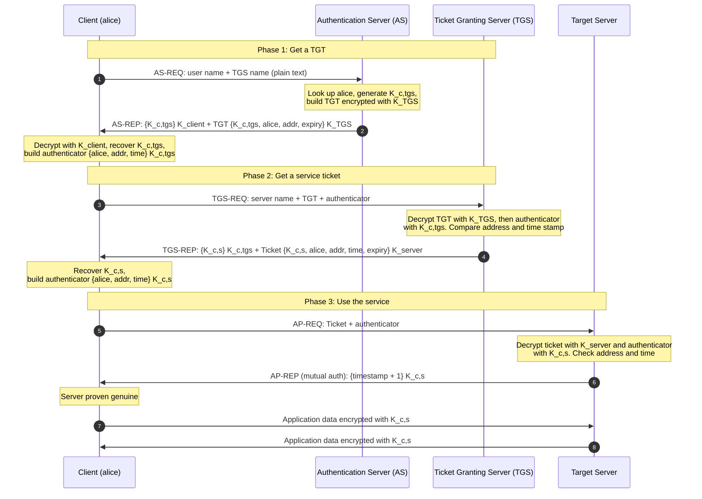
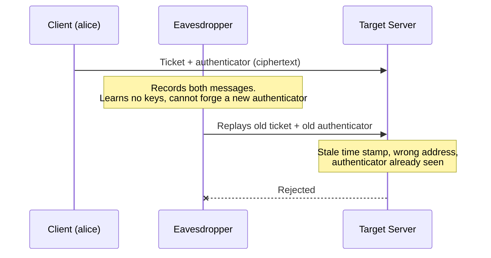
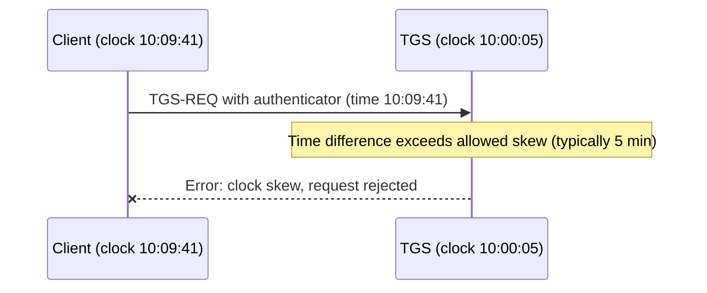
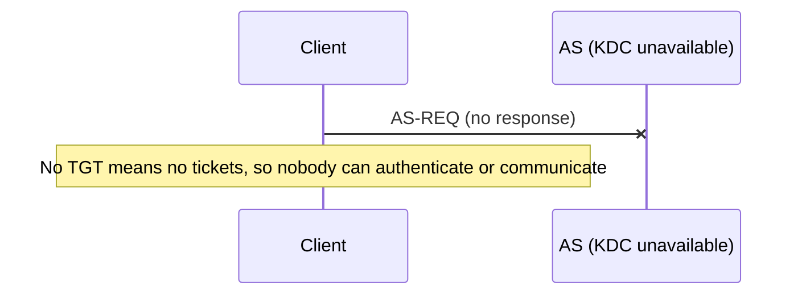

# Kerberos Authentication: Study Guide and Step Diagrams

> This file contains all the content plus **Mermaid diagrams** (they render in GitHub, GitLab, Obsidian, VS Code preview, Typora, Notion, etc.). For the animated version

---

## 1. Idea in One Analogy (Theme Park)

You don't pay at every ride. At the **gate desk (AS)** you prove who you are once and get a **day wristband (TGT)**. At the **ride office (TGS)** you swap the wristband for a **ride ticket**. At the **ride (target server)** you show the ticket. Every handover is sealed with a secret key and every note you sign carries the time, so copies can't be reused. Your password is never sent over the network.

## 2. Working Principle

Kerberos is **trusted third-party authentication with symmetric keys**. The KDC shares a secret key with every user and service, so it can hand out credentials that only the intended party can open.

1. **Prove identity once:** the AS verifies the user and issues a TGT.
2. **Trade the TGT for tickets:** the TGS issues a ticket per service, so no more passwords are needed (single sign-on).
3. **Prove it freshly every time:** each request carries an authenticator (name, address, time stamp) encrypted with a session key.
4. **The server verifies locally:** it opens the ticket with its own key; no call to the KDC is needed.
5. **Optionally prove the server too:** mutual authentication, then protect data with the shared session key.

**Background:** Developed at the Massachusetts Institute of Technology (MIT), Kerberos became a popular network authentication protocol for indirect, third-party authentication. It uses symmetric encryption between users, the KDC and applications, giving **confidentiality**, but it does **not** protect against brute force on passwords or compromise of the data stored in the KDC. It is an operational implementation of key distribution technology offering a key distribution center, an authentication service and a ticket granting service. Hosts, applications and servers must all be "Kerberized". Its centralized architecture reduces administrative effort because all authentication is managed from one server.

**Security goals supported:** Authentication (users are who they claim to be), Confidentiality (data kept secret), Integrity (data received is the same as data sent).

## 3. Key Legend

| Key | Meaning |
|---|---|
| `K_client` | Alice's secret key (derived from her password), known to client and AS |
| `K_TGS` | Long-term secret key of the TGS (known to AS and TGS) |
| `K_server` | Long-term secret key of the target server (known to TGS and server) |
| `K_c,tgs` | Session key for client and TGS |
| `K_c,s` | Session key for client and target server |

## 4. Full Protocol (Mermaid Sequence Diagram)



## 5. Step-by-Step Explanation

For each step: **Principle** (why it exists), **Plain words** (analogy), **Technical detail** (from the course text).

### Phase 1: Get the TGT (AS)

**Step 1: Request a ticket for the TGS (AS-REQ)**
- **Principle:** Identify yourself to a trusted third party without revealing any secret. Only a name is sent.
- **Plain words:** At the gate desk you say "I'm alice, I'd like a day wristband." Your password is not sent.
- **Technical:** Before a subject can request a service from an object, it must obtain a ticket. It asks the AS for a ticket to the TGS. The message contains the user's name and the name of the TGS.

**Step 2: AS prepares the reply**
- **Principle:** The KDC knows every secret key, so it can seal data only the intended party can open.
- **Plain words:** The desk finds you on its guest list, makes a wristband only the ride office can read, and puts a secret code in an envelope only you can open.
- **Technical:** The AS looks up the subject in its database, generates a session key for use between the subject and the TGS, encrypts it with the subject's secret key, then creates a TGT and encrypts it with the TGS's secret key.

**Step 3: AS sends session key + TGT (AS-REP)**
- **Principle:** Encrypt for the right reader. The user cannot read or alter the TGT.
- **Plain words:** You get a sealed envelope (you can open it) and the wristband (sealed, just carry it).
- **Technical:** The AS sends both encrypted messages back to the subject.

**Step 4: Client recovers the session key**
- **Principle:** Holding a key proves identity; the time-stamped authenticator makes the proof fresh.
- **Plain words:** You open the envelope with your own key and sign a note with the new code and the time.
- **Technical:** The subject decrypts the first message and recovers the session key, then creates an authenticator (name, address, time stamp) encrypted with that session key.

### Phase 2: Get a service ticket (TGS)

**Step 5: Ask the TGS for a server ticket (TGS-REQ)**
- **Principle:** Single sign-on. The TGT lets alice request service tickets without re-entering her password.
- **Plain words:** At the ride office you show the wristband and signed note and name the ride you want.
- **Technical:** The request contains the server name, the TGT (already encrypted with the TGS's key) and the encrypted authenticator.

**Step 6: TGS validates the request**
- **Principle:** Two independent checks (ticket and authenticator) must agree on key, address and time.
- **Plain words:** The office unseals the wristband and checks your note: same name, same place, fresh time.
- **Technical:** The TGS decrypts the TGT with its secret key, then uses the session key inside to decrypt the authenticator. It compares the network address with the sender's address and the time stamp with the current time. If everything matches, the request proceeds.

**Step 7: TGS issues a service ticket (TGS-REP)**
- **Principle:** The KDC mints a fresh key shared only by alice and that server; the server never needs to contact the KDC.
- **Plain words:** You get a ride ticket sealed for the operator, plus a new secret code.
- **Technical:** The TGS creates a new session key for user and target server and puts it into a ticket containing name, address, time stamp and expiration time, all encrypted with the target server's secret key. The new session key is also encrypted using the client-TGS session key. Both messages are sent to the subject.

**Step 8: Client builds a new authenticator**
- **Principle:** Every request carries a new proof, so old copies are useless.
- **Plain words:** You sign a fresh note with the new code and the current time.
- **Technical:** The subject decrypts the message, extracts the target session key and creates a new authenticator encrypted with it.

### Phase 3: Use the service (target server)

**Step 9: Present ticket to the target server (AP-REQ)**
- **Principle:** The server trusts the ticket because only the KDC could have sealed it with the server's key.
- **Plain words:** At the ride you hand over the ticket and signed note. A thief who copies them can't reuse them later.
- **Technical:** The subject sends the ticket (already encrypted with the server's key) and the encrypted authenticator. The authenticator contains plaintext encrypted with the session key, so it proves the sender knows the key. Encrypting the time of day prevents an eavesdropper who records both from replaying them later.

**Step 10: Server checks ticket and authenticator**
- **Principle:** Verification is local; no call to the KDC is needed.
- **Plain words:** The operator opens the ticket with its own key and checks your note.
- **Technical:** The server decrypts and checks the ticket and authenticator, confirming the address and time stamp. It now knows the subject is who they claim to be, and both share a key. Since only they hold it, a recent message encrypted in that key must originate with the other party.

**Step 11: Server proves itself, mutual authentication (AP-REP)**
- **Principle:** Authentication in both directions.
- **Plain words:** The operator proves it's the real ride by answering with your note's time plus one.
- **Technical:** For applications requiring mutual authentication, the server sends a message consisting of the time stamp plus one, encrypted with the session key. This proves the server knew its secret key and could decrypt the ticket and authenticator.

**Step 12: Client verifies the server**
- **Principle:** Confirm the server's identity before sending sensitive data.
- **Plain words:** You check the answer; the ride is genuine.

**Step 13: Secure session established**
- **Principle:** The shared session key gives confidentiality and integrity for all further data.
- **Plain words:** You and the ride now talk using the shared secret code; nobody else can read or change it.

## 6. Failure Scenarios

### 6.1 Replay attack



Limited lifetimes and encrypted time stamps defeat replays.

### 6.2 Clock out of sync



Kerberos requires **trusted and synchronized clocks** across the enterprise network.

### 6.3 KDC down (single point of failure)



Mitigation: **replicated KDCs** and **physical protection**. A compromised KDC would give an attacker unlimited access to everything.

## 7. Implementation Considerations

- Overall security depends on careful implementation.
- Trusted and synchronized clocks are required across the enterprise network.
- Limited authentication lifetimes based on time stamps reduce the threat of fraudulent credentials.
- The KDC must be physically secure.
- The KDC must be isolated on the network and should not participate in any non-Kerberos activity.
- The AS can be a critical single point of failure.
- All devices must use Kerberos; if the KDC is unavailable, no one can communicate.

## 8. Pros and Cons

| Advantages | Disadvantages |
|---|---|
| **Single sign-on:** log in once, access many services | **Single point of failure:** KDC down means no authentication |
| **Passwords never travel** over the network | **KDC compromise** gives an attacker everything |
| **Mutual authentication** vs fake servers | **Clock synchronization** is mandatory (about 5 minutes) |
| **Replay protection** via time stamps and lifetimes | **Offline password guessing** of weak passwords (e.g. AS-REP roasting, Kerberoasting) |
| **Centralized management** reduces admin effort | **Every host and app must be Kerberized**; setup and troubleshooting are complex (DNS, time, key tables) |
| **Fast** symmetric cryptography; reusable tickets reduce KDC load | **Revocation is hard:** tickets valid until expiry; stolen tickets can be abused (pass-the-ticket) |
| **Open standard** (RFC 4120), many implementations, cross-platform | KDC holds **every secret key**, so storage must be strongly protected |
| **Cross-realm trust** between organizations | |

## 9. Where Kerberos Is Deployed

| Domain | Examples |
|---|---|
| Commercial / enterprise | Microsoft **Active Directory** uses Kerberos by default for logins, file shares, Exchange mail, SQL Server and intranet sites |
| Government and defense | Windows domains with Kerberos, often combined with smartcards or PKI for stronger first login |
| Education and research | MIT and many campus networks: login, mail, AFS and NFS |
| Big data and cloud | Secure Hadoop clusters (HDFS, Hive, Spark, Kafka); Azure AD Domain Services and AWS Directory Service offer Kerberos |
| Unix / Linux servers | SSH (GSSAPI), NFSv4, Samba, PostgreSQL, Oracle, web SSO (SPNEGO), IMAP/SMTP |
| Healthcare and telecom IT | Internal corporate IT: staff logins, back-office and management systems |
| Operating systems | Built into Windows (since Windows 2000), macOS, most Linux distributions (MIT Kerberos, Heimdal, SSSD) |

*Deployment examples come from general industry knowledge; confirm specifics before citing in a report.*

## 10. Kerberos Tools (Windows Server 2003 Resource Kit Tools)

A free implementation of Kerberos is available from MIT, and it exists in many commercial products. The Resource Kit Tools help administrators manage tasks such as troubleshooting, managing Active Directory, configuring networking and security, and automating deployment.

| Tool | Purpose |
|---|---|
| **Kerbtray.exe** (Kerberos Tray) | GUI showing ticket information; lets a user view and purge the ticket cache |
| **Klist.exe** (Kerberos List) | Command-line tool to view and delete tickets of the current logon session; must run on a member of a Kerberos realm. Shows the TGT to a KDC in Windows and the TGT to Kserver on UNIX |
| **Ksetup.exe** (Kerberos Setup) | Command-line tool for Kerberos interoperability: map local accounts to Kerberos V5 accounts, set the computer's password in the realm, change a user's password in a Kerberos V5 realm |

Example `klist` output after Step 8:

```
C:\> klist
Current LogonId: alice@EXAMPLE.REALM
Cached Tickets: (2)
#0>  Client: alice @ EXAMPLE.REALM
     Server: krbtgt/EXAMPLE.REALM  (TGT)
#1>  Client: alice @ EXAMPLE.REALM
     Server: host/server1.example.realm
```

## 11. Glossary: Terms and Full Forms

| Term | Full form / meaning |
|---|---|
| Kerberos | Network authentication protocol from MIT using symmetric encryption and tickets |
| MIT | Massachusetts Institute of Technology |
| KDC | Key Distribution Center: holds all secret keys; contains the AS and TGS |
| AS | Authentication Server (Service): verifies the user, issues the TGT |
| TGS | Ticket Granting Server (Service): swaps a TGT for a service ticket |
| TGT | Ticket-Granting Ticket: proof of login, encrypted with the TGS's key |
| Ticket | Credential for one server, encrypted with that server's key; holds session key, name, address, time stamp, expiry |
| Authenticator | Name, address and time stamp encrypted with a session key; proves knowledge of the key and freshness |
| Secret key | Long-term key shared with the KDC (`K_client`, `K_TGS`, `K_server`) |
| Session key | Temporary key for one conversation (`K_c,tgs`, `K_c,s`) |
| Subject / Object | Access control subject: user or process requesting access. Object: server or resource being accessed |
| Kerberized | Host, application or server able to use Kerberos tickets |
| Realm | Administrative domain managed by one KDC |
| AS-REQ / AS-REP | Authentication Service Request / Reply |
| TGS-REQ / TGS-REP | Ticket Granting Service Request / Reply |
| AP-REQ / AP-REP | Application Request / Reply (client to target server, incl. mutual authentication) |
| SSO | Single Sign-On |
| SPOF | Single Point of Failure |
| CIA goals | Confidentiality, Integrity (plus Authentication, as listed in the text) |
| Mutual authentication | Both sides prove identity (server returns time stamp + 1) |
| Replay attack | Attacker resends recorded valid messages; stopped by time stamps and lifetimes |
| Brute force | Trying every possible password or key |
| GUI | Graphical User Interface |
| Kerbtray / Klist / Ksetup | Kerberos Tray / Kerberos List / Kerberos Setup |

---

*Process adapted from Bruce Schneier, "Applied Cryptography: Protocols, Algorithms, and Source Code in C" (1993). Message names (AS-REQ, TGS-REP, etc.) follow the Kerberos V5 convention. Analogy, scenarios, pros/cons and deployment examples are added explanatory material.*
