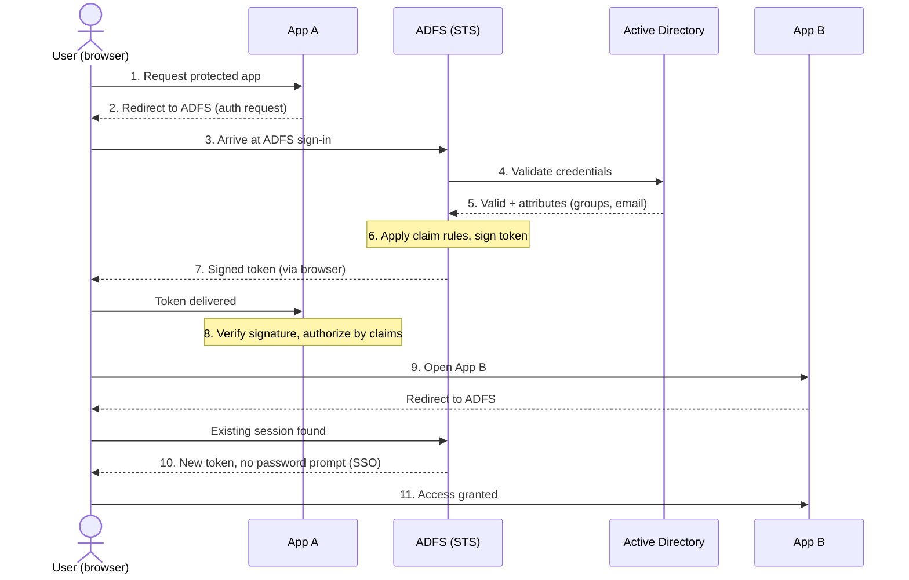
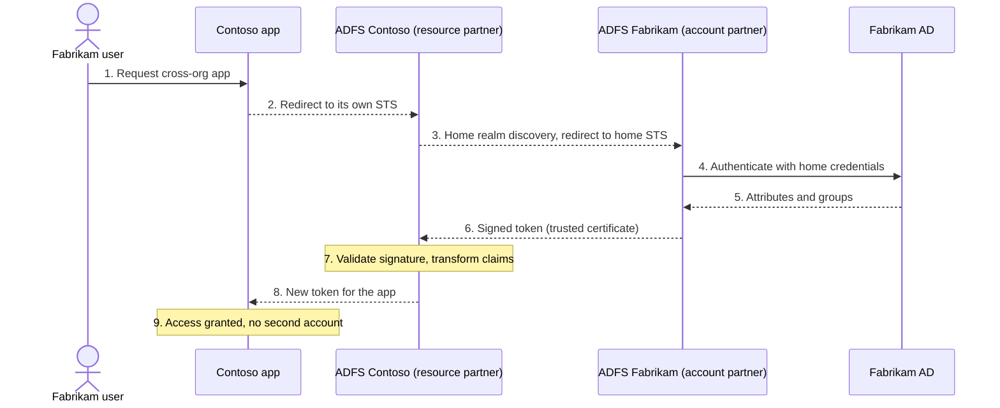
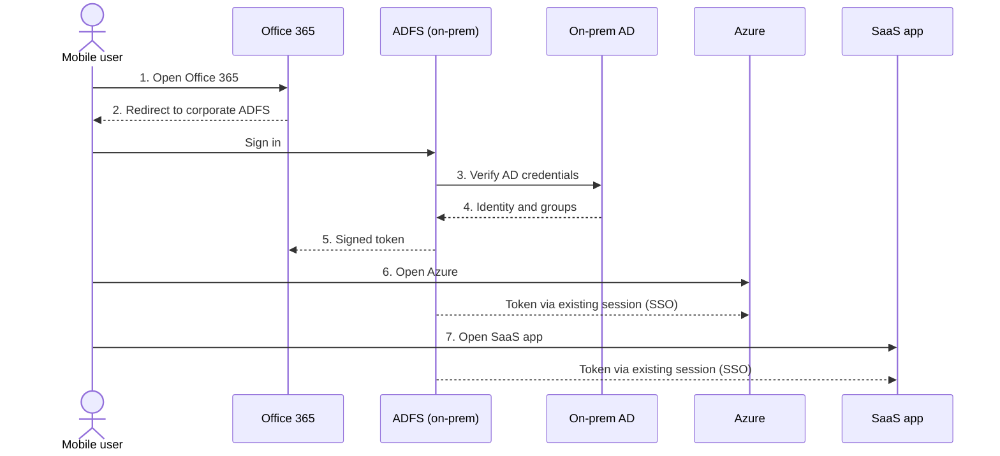

# ADFS, Federated Identity (FIM) & SSO: Complete Guide

A text version of the interactive simulator. Animations become **Mermaid sequence diagrams** (rendered by GitHub, GitLab, VS Code, Obsidian, Notion and most Markdown viewers).

---

## 1. Summary

**ADFS** (Active Directory Federation Services) is Microsoft's implementation of **FIM** (Federated Identity Management). Its **STS** (Security Token Service) checks users against **AD** (Active Directory) and issues signed tokens full of **claims**. Apps trust the token, which gives users **SSO** (Single Sign-On) and lets partner organizations share access securely (**B2B**), including to cloud services such as Microsoft 365, Azure and SaaS apps.

**Analogy (airport):** ADFS is the passport office. It checks who you are once and gives you a stamped boarding pass (token). Apps are airline gates that never see your passport, they only trust the stamp. Active Directory is the national citizen register.

---

## 2. Core Concepts

| Concept | Explanation |
|---|---|
| **FIM** | Shares identity information and authentication across different security domains, inside or between organizations (federated partners). |
| **Claims-based authentication** | Claims are key/value pairs about the user (name, email, group, role). Apps read claims in a signed token and make authentication and authorization decisions. Apps never see the password. |
| **STS** | The ADFS component that issues security tokens containing claims. |
| **SSO** | Log in once, access many apps without re-entering credentials. |
| **Federated identity / trust** | Organizations establish trust so users can access resources across domains. The *account partner* holds the users; the *resource partner* holds the apps. |
| **AD integration** | Uses existing AD accounts and groups; no new directory needed. |
| **Cloud services** | Connects on-premises AD to Office 365, Azure and third-party SaaS using familiar AD credentials. |
| **Web and mobile access** | Secure access to internal and external web apps from any device with consistent policy. |

---

## 3. Glossary (Full Forms)

| Term | Full form | Meaning |
|---|---|---|
| ADFS | Active Directory Federation Services | Microsoft's federated identity product on top of AD |
| FIM | Federated Identity Management | Sharing identity across domains or organizations |
| SSO | Single Sign-On | One login, many apps |
| STS | Security Token Service | Issues signed security tokens |
| AD | Active Directory | Directory of users, groups and passwords |
| AD DS | Active Directory Domain Services | AD role that stores and authenticates users |
| IdP | Identity Provider | System that authenticates users and vouches for them |
| RP | Relying Party | App that relies on the IdP's token |
| Claim | Key/value fact about a user | e.g. `group = Finance` |
| Token | Security token | Digitally signed package of claims |
| SAML | Security Assertion Markup Language | XML token standard |
| JWT | JSON Web Token | Compact JSON token format |
| OAuth / OIDC | Open Authorization / OpenID Connect | Modern delegated access and sign-in protocols |
| WS-Fed | Web Services Federation | Federation protocol used by ADFS and Office 365 |
| LDAP | Lightweight Directory Access Protocol | Protocol for querying directories |
| Kerberos | (Network authentication protocol) | Ticket-based protocol used for AD domain logins |
| UPN | User Principal Name | Email-style login, e.g. alex@contoso.com |
| HRD | Home Realm Discovery | Finding which organization a user belongs to |
| MFA | Multi-Factor Authentication | Extra proof on top of a password |
| B2B | Business-to-Business | Collaboration between separate organizations |
| SaaS | Software as a Service | Cloud apps used over the web |
| O365 | Office 365 (now Microsoft 365) | Microsoft cloud suite federated via ADFS |

---

## 4. Simulations

Legend: 🔵 request/redirect, 🟠 credentials/lookup, 🟢 token with claims.

### 4.1 SSO in the Enterprise

| Step | What happens | In plain words |
|---|---|---|
| 1 | User requests App A | You knock on a door without a pass |
| 2 | App redirects to ADFS | "I don't know you. Get proof from the ID office." |
| 3 | Browser reaches ADFS | You arrive at the ID office, not yet checked today |
| 4 | ADFS validates against AD | The office phones the register; your password stays inside the company |
| 5 | AD returns identity | "Yes, this is Alex, in Finance" |
| 6 | STS builds a signed token | A signed note lists facts about you (claims) |
| 7 | Token delivered to App A | You carry the note back |
| 8 | App A authorizes | It checks the signature and reads `group = Finance` |
| 9 | User opens App B | You walk to a second door |
| 10 | SSO | ADFS remembers you and issues a new note instantly |
| 11 | App B grants access | Zero extra logins |

**Example claims:** `name: Alex Kim`, `email: alex@contoso.com`, `group: Finance`, `role: Analyst`

### 4.2 Federation Between Organizations (B2B)

Analogy: two countries with a visa agreement. Contoso trusts Fabrikam's passport and issues its own entry permit.

| Step | What happens |
|---|---|
| 1 | Partner user opens a Contoso app |
| 2 | App redirects to Contoso ADFS (resource partner) |
| 3 | Home realm discovery sends the user to Fabrikam ADFS |
| 4 | User signs in at home; passwords never leave Fabrikam |
| 5 | Fabrikam AD returns attributes |
| 6 | Fabrikam STS signs a token with claims (`upn`, `dept`, `groups`) |
| 7 | Contoso validates the signature and maps claims (e.g. `Sales` becomes `External-Collaborator`) |
| 8 | Contoso issues its own token for the app |
| 9 | App grants access without creating a new account |

### 4.3 Cloud Services and Mobile

One identity, many services, with the same policies on laptop or phone.

---

## 5. Working Principle (Step by Step)

**In one line:** instead of every app checking passwords itself, apps trust one identity authority (the ADFS STS). The user proves identity once, and the authority returns a signed token of claims that any trusting app can verify.

| # | Step | Description | ✅ Benefit | ⚠️ Watch-out |
|---|---|---|---|---|
| 1 | Establish trust (one-time) | Exchange federation metadata and signing certificates (relying party and claims provider trusts); define claim rules | Passwords never shared; configured once, reused | Certificate expiry or bad metadata breaks sign-in for everyone |
| 2 | User requests app | App finds no valid session | Apps need no password database | Every app must be registered with ADFS |
| 3 | Redirect to STS | Browser sent to ADFS using SAML, WS-Federation or OIDC/OAuth | Standard protocols work across vendors | Redirect loops and clock skew are hard to debug |
| 4 | Authenticate against AD | Forms, Kerberos, smart card/certificate or MFA | Reuses AD accounts and groups; central MFA | AD or ADFS outage blocks all logins unless highly available |
| 5 | Collect attributes, apply claim rules | Attributes become filtered, transformed claims | Fine-grained access and data minimization | Complex rule sets are hard to maintain |
| 6 | STS issues signed token | SAML or JWT signed with the STS private key | Tamper-evident; apps verify without calling AD | Stolen valid token can be replayed, so keep lifetimes short |
| 7 | App validates and authorizes | Check signature, audience, expiry, then claims | Consistent authorization across internal, cloud and mobile | Apps must map claims to roles correctly |
| 8 | Session reuse gives SSO | Next app gets a new token without a prompt | Fewer passwords, less help-desk load | One hijacked session opens many apps, so use MFA and sign-out policy |

---

## 6. Pros and Cons

### ✅ Advantages
- One login for many apps improves productivity and user experience
- Reuses existing AD users and groups; no second directory
- Passwords stay in the home domain; apps only see signed claims
- Trust-based B2B access without duplicate partner accounts
- Central policy, MFA and auditing
- Bridges on-premises AD with Microsoft 365, Azure and SaaS
- Fewer password resets lowers help-desk cost
- Control stays on-premises where compliance requires it

### ⚠️ Limitations
- Needs its own infrastructure: ADFS farm, Web Application Proxy, load balancers, certificates
- Single point of failure unless deployed highly available
- Ongoing certificate and metadata management
- Claim rules and trusts can become complex
- Higher operational cost than cloud identity services
- Microsoft now recommends Microsoft Entra ID for new cloud-first deployments, so ADFS mostly suits existing or on-premises-driven needs
- Compromise of the STS signing key affects every trusting app

---

## 7. Where It Is Deployed

| Domain | Typical use |
|---|---|
| 🏢 **Commercial / enterprise** | Staff SSO to Microsoft 365, Azure, SaaS (Salesforce, ServiceNow, Workday style apps) and internal portals; connecting two directories after a merger; supplier and partner extranets |
| 🛡️ **Defense & public safety** | Federation combined with smart-card (PKI) authentication such as the US Common Access Card; coalition information sharing where allied nations keep their own identity systems and trust each other's tokens (the idea behind NATO's Federated Mission Networking); strict claim-based clearance and role checks; on-premises control of sensitive data |
| 🏛️ **Government** | Citizen and employee portals; cross-agency services without sharing user databases |
| 🎓 **Education & research** | Campus-wide SSO; inter-university SAML federations such as InCommon (US) |
| 🏥 **Healthcare** | One secure login to records, labs and imaging; role-based claims supporting privacy rules such as HIPAA |
| 🏦 **Finance & insurance** | SSO with MFA across trading, CRM and compliance apps; agent, broker and auditor access |
| 🏭 **Manufacturing, retail & logistics** | Vendor and distributor portals; mobile workers reaching inventory and HR apps |
| ☁️ **Cloud & mobile** | Hybrid identity for Microsoft 365 and Azure; same policy on laptop, browser or phone via Web Application Proxy |

> These are common deployment patterns, not specific named customers. Verify details against current vendor documentation before designing a real system.
